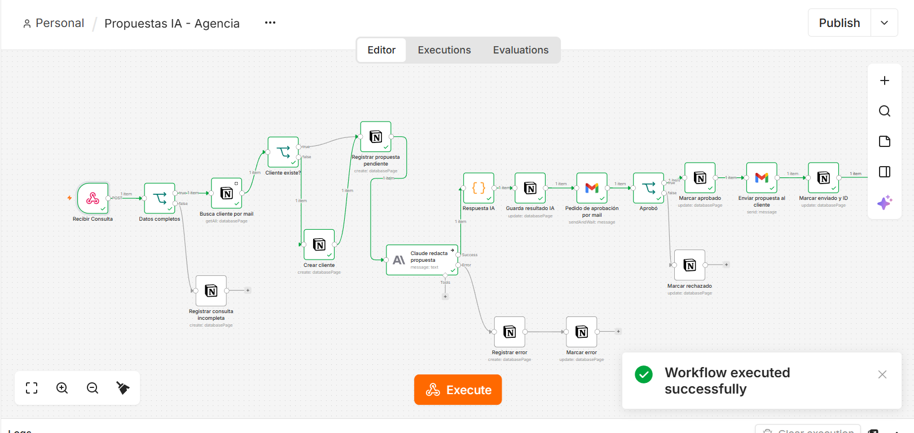
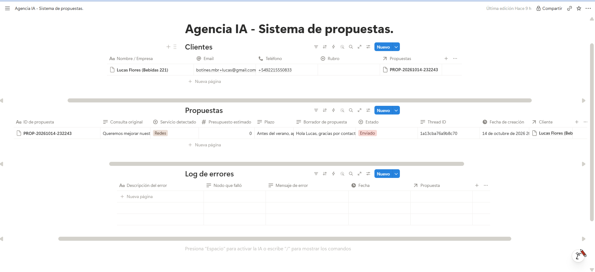
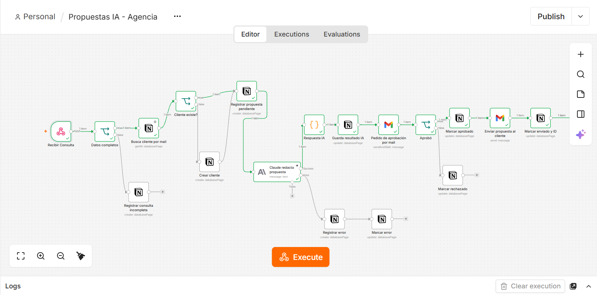
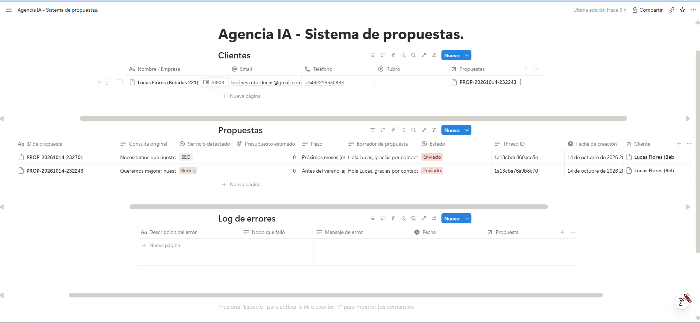
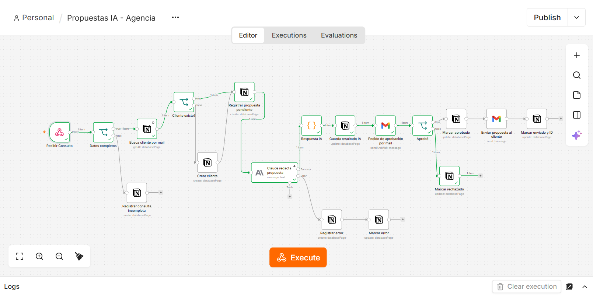
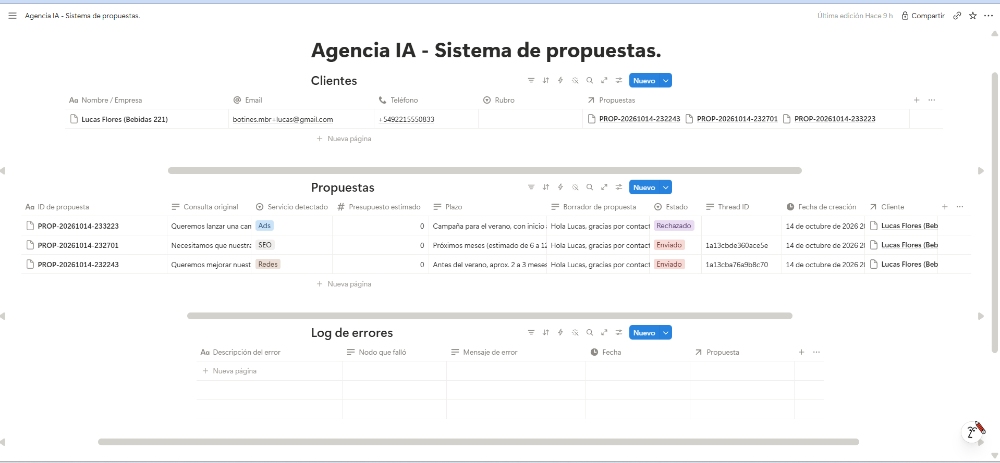
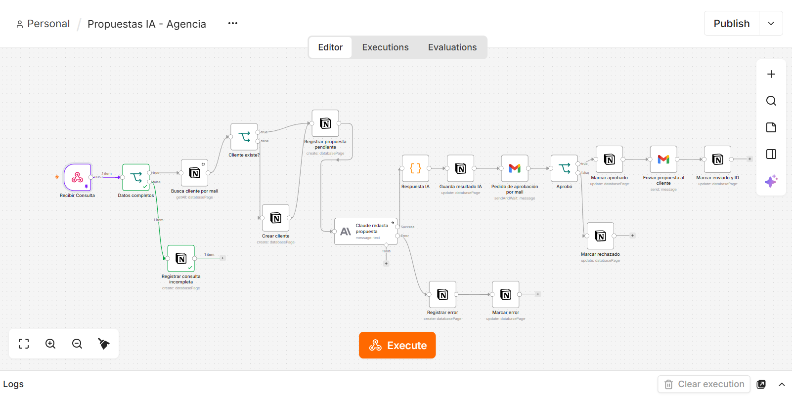
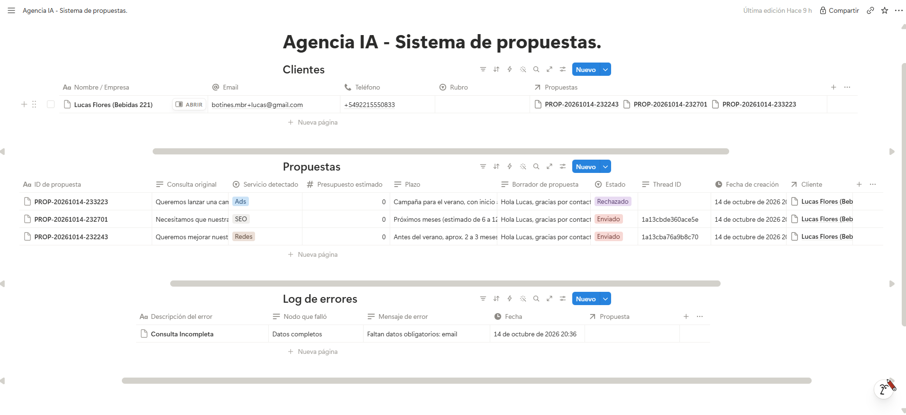
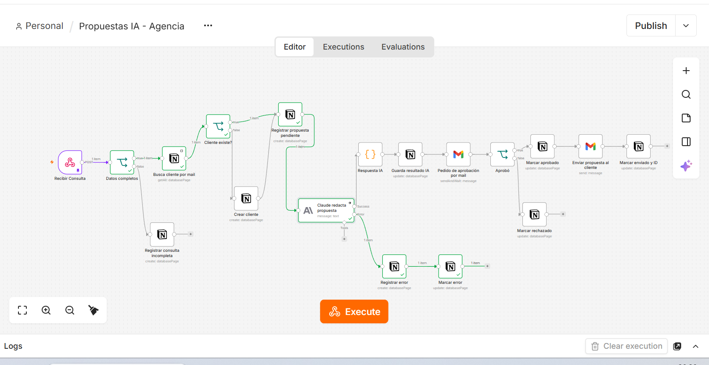
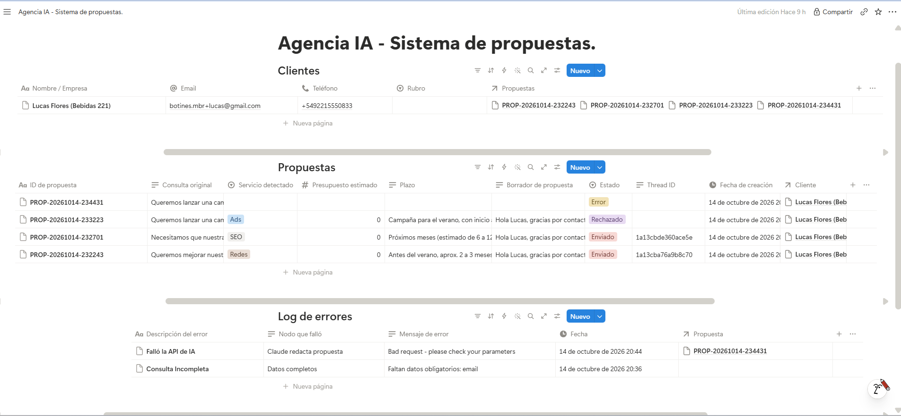

# Ecosistema de Automatización IA: propuestas comerciales personalizadas

Proyecto final del curso de AI Automation. Es un flujo en **n8n** que recibe consultas de clientes en lenguaje natural, las interpreta con **Claude**, redacta una propuesta comercial personalizada y la envía al cliente **solo después de que una persona la apruebe**. Todo el recorrido queda registrado en **Notion**.

> Cliente ficticio: una agencia de marketing digital que ofrece SEO, Redes sociales, Publicidad paga (Ads) y Diseño web.

## Enlaces

| Recurso | Enlace |
|---|---|
| Base de datos en Notion (solo lectura) | https://sponge-anger-cd7.notion.site/Agencia-IA-Sistema-de-propuestas-3ea0c8cb1e01804980a9f2d4e4f7c90e |
| Video demo (3 min) | PEGAR_LINK_VIDEO |
| Diagrama de arquitectura (PDF) | [docs/arquitectura.pdf](docs/arquitectura.pdf) |
| Flujo de n8n (JSON) | [flujo/propuestas-ia-agencia.json](flujo/propuestas-ia-agencia.json) |

## Qué hace

1. Llega una consulta por **Webhook** (nombre, empresa, email, teléfono y mensaje).
2. Un filtro verifica que estén el email y el mensaje. Si falta alguno, se registra en el Log de errores y el flujo se detiene.
3. Busca al cliente por email en Notion. Si no existe lo crea, y en los dos casos lo vincula a la propuesta.
4. Registra la propuesta con estado **Pendiente**.
5. **Claude** lee la consulta y devuelve un JSON con servicio detectado, presupuesto estimado, plazo y un borrador de propuesta.
6. El resultado se guarda en Notion con estado **Procesado por IA**.
7. Se envía un email de aprobación con el borrador y dos botones (**Aprobar y enviar** / **Rechazar**). El flujo queda en pausa hasta que alguien responde.
8. Si se aprueba: estado **Aprobado por Humano**, se envía la propuesta al cliente por Gmail y se guarda el **Thread ID** con estado **Enviado**. Si se rechaza: estado **Rechazado** y no se envía nada.
9. Si la API de IA falla, se registra el error en el Log de errores y la propuesta queda en estado **Error**.

## Arquitectura

```
Webhook -> Datos completos? -> Buscar cliente -> Existe? -> (si no) Crear cliente
        -> Registrar propuesta (Pendiente) -> Claude -> Parsear JSON
        -> Guardar resultado (Procesado por IA) -> Email de aprobación (pausa)
        -> Aprobó? -> si:  Aprobado -> Enviar al cliente -> Enviado + Thread ID
                   -> no:  Rechazado

Errores:  falla de la IA        -> Log de errores + estado Error
          datos incompletos     -> Log de errores
```

El diagrama completo está en [docs/arquitectura.pdf](docs/arquitectura.pdf).

| Capa | Herramienta |
|---|---|
| Base de datos ("cerebro") | Notion |
| Orquestación ("corazón") | n8n Cloud |
| Motor de IA | Claude (modelo `claude-haiku-5-5`) vía API de Anthropic |
| Aprobación y salida ("voz") | Gmail |

## Base de datos (Notion)

**Clientes**: Nombre / Empresa, Email, Teléfono, Rubro, Propuestas (relación con Propuestas).

**Propuestas**: ID de propuesta, Consulta original, Servicio detectado (SEO, Redes, Ads, Web), Presupuesto estimado, Plazo, Borrador de propuesta, **Estado**, Thread ID, Fecha de creación, Cliente (relación con Clientes).

**Log de errores**: Descripción del error, Nodo que falló, Mensaje de error, Fecha, Propuesta (relación con Propuestas).

**Estados de una propuesta:** Pendiente → Procesado por IA → Aprobado por Humano → Enviado. Los desvíos son **Rechazado** y **Error**.

## Decisiones de diseño

- **Trigger específico:** un Webhook que solo se activa cuando llega una consulta, sin consumir operaciones de más.
- **Motor de IA:** el prompt es dinámico (usa nombre, empresa y mensaje del Webhook), pide una salida en JSON con claves fijas y fija la firma "Equipo Comercial" para que el texto salga listo para enviar. El límite de **Max Tokens es 2500**: con 600 el modelo gastaba todo en razonamiento interno y se cortaba antes de escribir la respuesta.
- **Resiliencia:** el nodo de Claude tiene configurada su salida de error. Si falla, se guarda un registro en Notion y la propuesta se marca como Error. Un Code parsea la respuesta buscando el bloque de texto y avisa con un error claro si no existe.
- **Human-in-the-loop:** el flujo se detiene en un email de aprobación (Gmail, *Send and Wait for Response*) y solo contacta al cliente si la persona aprueba.
- **Salida:** Gmail, con el `threadId` guardado en Notion para mantener la conversación organizada. No se usó WhatsApp.

## Check de seguridad

| Pregunta | Respuesta |
|---|---|
| ¿Hay un filtro para evitar bucles infinitos? | El flujo es lineal, sin ciclos, y arranca solo con un POST externo. Ninguna escritura en Notion lo dispara de nuevo, porque no usa triggers de Notion. |
| ¿Se comparan tipos de datos correctos? | La decisión de aprobación se compara como Boolean, el presupuesto se convierte con `Number()` y los filtros de texto usan *is not empty* sobre strings. |
| ¿El prompt es dinámico? | Sí, usa variables del Webhook. |

## Pruebas de estrés

Se ejecutó el flujo 5 veces, incluyendo los caminos infelices.

| # | Caso | Resultado esperado |
|---|---|---|
| 1 | Éxito con cliente nuevo | Crea cliente y propuesta; al aprobar queda Enviado con Thread ID |
| 2 | Éxito con cliente existente | No duplica el cliente; reutiliza el existente |
| 3 | Rechazo humano | Estado Rechazado y no se envía nada al cliente |
| 4 | Datos incompletos (sin email) | Fila en Log de errores y no se crea propuesta |
| 5 | Falla de la IA | Fila en Log de errores y propuesta en estado Error |

### Prueba 1: éxito con cliente nuevo




### Prueba 2: éxito con cliente existente




### Prueba 3: rechazo humano




### Prueba 4: datos incompletos




### Prueba 5: falla de la IA




## Capturas del proceso de construcción

| # | Qué muestra | Archivo |
|---|---|---|
| 01 | Lienzo de n8n | [construccion-01-n8n-flujo.png](evidencias/construccion/construccion-01-n8n-flujo.png) |
| 02 | Lienzo de n8n | [construccion-02-n8n-flujo.png](evidencias/construccion/construccion-02-n8n-flujo.png) |
| 03 | Tablas de Notion | [construccion-03-notion-tablas.png](evidencias/construccion/construccion-03-notion-tablas.png) |
| 04 | Lienzo de n8n | [construccion-04-n8n-flujo.png](evidencias/construccion/construccion-04-n8n-flujo.png) |
| 05 | Tablas de Notion | [construccion-05-notion-tablas.png](evidencias/construccion/construccion-05-notion-tablas.png) |
| 06 | Flujo con aprobación humana | [construccion-06-n8n-aprobacion-humana.png](evidencias/construccion/construccion-06-n8n-aprobacion-humana.png) |
| 07 | Estados en Notion | [construccion-07-notion-estados.png](evidencias/construccion/construccion-07-notion-estados.png) |
| 08 | Email de aprobación en Gmail | [construccion-08-gmail-email-aprobacion.png](evidencias/construccion/construccion-08-gmail-email-aprobacion.png) |
| 09 | Rama de aprobación y rechazo | [construccion-09-n8n-aprobacion-rechazo.png](evidencias/construccion/construccion-09-n8n-aprobacion-rechazo.png) |
| 10 | Estado Rechazado en Notion | [construccion-10-notion-estado-rechazado.png](evidencias/construccion/construccion-10-notion-estado-rechazado.png) |
| 11 | Lienzo de n8n | [construccion-11-n8n-flujo.png](evidencias/construccion/construccion-11-n8n-flujo.png) |
| 12 | Email en Gmail | [construccion-12-gmail-email.png](evidencias/construccion/construccion-12-gmail-email.png) |
| 13 | Lienzo de n8n | [construccion-13-n8n-flujo.png](evidencias/construccion/construccion-13-n8n-flujo.png) |
| 14 | Tablas de Notion | [construccion-14-notion-tablas.png](evidencias/construccion/construccion-14-notion-tablas.png) |
| 15 | Camino infeliz en el flujo | [construccion-15-n8n-camino-infeliz.png](evidencias/construccion/construccion-15-n8n-camino-infeliz.png) |
| 16 | Log de errores por consulta incompleta | [construccion-16-notion-log-consulta-incompleta.png](evidencias/construccion/construccion-16-notion-log-consulta-incompleta.png) |

## Cómo importar el flujo

1. En n8n, andá a **Workflows → Import from file** y elegí `flujo/propuestas-ia-agencia.json`.
2. Creá tus propias credenciales: **Notion API**, **Anthropic** y **Gmail (OAuth2)**, y asignalas a los nodos correspondientes.
3. Apuntá los nodos de Notion a tus bases (Clientes, Propuestas y Log de errores) y cambiá el destinatario del email de aprobación por el tuyo.
4. Para probarlo, enviá un POST al Webhook con este cuerpo:

```json
{
  "nombre": "Nombre Apellido",
  "empresa": "Empresa de prueba",
  "email": "cliente@ejemplo.com",
  "telefono": "+5492210000000",
  "mensaje": "Queremos mejorar nuestro Instagram y hacer campañas pagas para el verano."
}
```

## Seguridad

El repositorio no incluye API keys, tokens ni la URL pública del Webhook. Las credenciales viven solo dentro de n8n.
